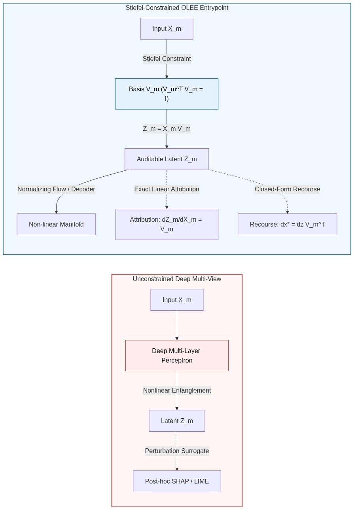

## Introduction

High-throughput biomedical studies routinely collect multiple distinct measurements from each subject. In neurodegenerative disease research, cohorts such as the Alzheimer's Disease Neuroimaging Initiative (ADNI) [@ADNI; @jack2008alzheimer] and the Parkinson's Progression Markers Initiative (PPMI) [@Marek2011] acquire structural MRI regional morphometry, diffusion tensor white matter fractional anisotropy, molecular PET, biofluid assays, and comprehensive psychometric batteries [@avants2014ants; @stone2020longitudinal; @avants2021]. In traumatic brain injury (TBI) and neurotrauma, blast-induced shockwave exposure produces diffuse axonal injury and non-local microstructural shearing that alter structural connectivity networks [@stone2024blast]. In translational oncology, the Cancer Genome Atlas (TCGA) profiles patient tumors across somatic copy-number alterations, transcriptomic expression, DNA methylation, and targeted reverse-phase protein arrays in breast invasive carcinoma (BRCA) [@tcga2012breast; @cancerdiscovery2016esr1] and clear cell renal cell carcinoma (KIRC) [@tcga2013kirc]. Integrating these observations—formalized as $M$ data matrices $\mathbf{X}_m \in \mathbb{R}^{n \times p_m}$ for $m = 1, \dots, M$ across $n$ co-registered subjects—is essential for resolving phenotypic heterogeneity, identifying molecular subtypes, and mapping progression trajectories.

Deep representation learning methods, including Deep Canonical Correlation Analysis (Deep CCA) [@andrew2013deep] and Multimodal Variational Autoencoders (MVAEs) [@wu2018multimodal], capture non-linear cross-modal dependencies. However, standard deep encoders map inputs through deeply nested affine transformations interleaved with non-linear activations ($\mathbf{Z} = \sigma(\mathbf{W}_2 \sigma(\mathbf{W}_1 \mathbf{X} + \mathbf{b}_1) + \mathbf{b}_2)$). This composition creates complex feature entanglement, obscuring the physical attribution between observable biological measurements and latent coordinates [@Rudin_2019]. In clinical diagnostics, oncology biomarker discovery, and neurotrauma assessment, this opacity imposes a severe **transparency penalty**: clinicians, regulatory agencies, and trial biostatisticians cannot determine whether a diagnostic score reflects authentic pathophysiology (such as entorhinal cortical atrophy or targeted kinase dysregulation) or idiosyncratic scanner noise and batch artifacts [@Holmberg_2022].

Post-hoc explainability techniques, such as LIME [@Ribeiro_2016] and SHAP [@Lundberg_2017], attempt to infer feature importance by querying black-box models on randomly perturbed inputs. As demonstrated by Rudin [-@Rudin_2019], post-hoc surrogates exhibit fundamental failure modes in biological domains. By perturbing features independently, they evaluate synthetic samples that violate physiological covariance—pairing, for example, incompatible regional brain volumes or mutually exclusive oncogenic mutations. Consequently, post-hoc explanations can be unstable, sensitive to hyperparameter tuning, and biologically deceptive [@Smith2023posthoc].

Conversely, classical linear dimensionality reduction methods—including Principal Component Analysis (PCA) and Canonical Correlation Analysis (CCA) [@hotelling1936relations]—provide exact linear loadings ($Z_{jk} = \sum_i X_{ji} V_{ik}$). Similarity-driven Multimodal Linear Reconstruction (SiMLR) [@avants2021] extended CCA to multiple modalities with sparsity and non-negativity constraints, solving a joint-variational problem on the Stiefel manifold. While linear SiMLR guarantees interpretability, complex disease processes can involve non-linear manifold geometry that linear projections cannot span. Furthermore, unconstrained PCA yields dense, mixed-sign loadings that lack anatomical specificity and fail to isolate shared cross-modal signals from modality-specific noise.

### The Only Linear Encoder Entrypoint (OLEE) Contract

To resolve the tension between non-linear expressivity and auditable feature attribution, we formulate Deep SiMLR governed by the **Only Linear Encoder Entrypoint (OLEE)** contract. OLEE mandates that the initial entrypoint for every modality is restricted to a linear projection on the compact Stiefel manifold:
$$
\mathbf{Z}_m = \mathbf{X}_m \mathbf{V}_m, \quad \text{subject to } \mathbf{V}_m \in \text{St}(k, p_m) = \{\mathbf{V} \in \mathbb{R}^{p_m \times k} \mid \mathbf{V}^\top \mathbf{V} = \mathbf{I}_k\}
$$
All downstream non-linear transformations—including volume-preserving normalizing flows, Riemannian quasi-Newton solvers, and non-linear decoders—operate exclusively on the low-dimensional latent coordinates $\mathbf{Z}_m \in \mathbb{R}^{n \times k}$.

Enforcing the OLEE contract yields three fundamental mathematical and clinical guarantees:

1. **Elimination of the Transparency Penalty:** Because the input mapping is strictly linear, the directional attribution gradient with respect to raw physical features is globally constant and analytically exact:
   $$
   \nabla_{\mathbf{X}_m} \mathbf{Z}_m = \mathbf{V}_m, \quad \frac{\partial Z_{m, ik}}{\partial X_{m, ij}} = V_{m, jk}
   $$
   Unlike black-box encoders where local gradients vary wildly across the input manifold, the OLEE loading matrix $\mathbf{V}_m$ directly encodes the physical contribution of every biological feature.
2. **Closed-Form Counterfactual Recourse:** In causal recourse and actionable intervention frameworks [@pearl2009causality; @Wachter_2017], a critical objective is determining what observable biomarker intervention $\Delta \mathbf{x}$ will produce a desired therapeutic shift $\Delta \mathbf{z}^*$ in disease state. Under standard deep encoders, calculating recourse requires non-convex gradient descent through non-linear latents, regularly synthesizing physically impossible biological states. Under the OLEE contract, forward latent shifts are instantaneous:
   $$
   \Delta \mathbf{Z}_m = \Delta \mathbf{X}_m \mathbf{V}_m
   $$
   while the minimal $L_2$-norm physical intervention required to achieve a target shift $\Delta \mathbf{z}_m^*$ is an exact orthogonal projection:
   $$
   \delta \mathbf{x}_m^* = \Delta \mathbf{z}_m^* \mathbf{V}_m^\top
   $$
   This delivers immediate, closed-form causal auditability without heuristic sampling.
3. **Spectral Noise Insulation:** To prevent high-dimensional isotropic noise from distorting consensus coordinates, we incorporate dynamic Modality Alignment Index (MAI) weighting based on singular value decay, down-weighting uninformative modalities during consensus optimization.

### Multimodal Consensus as Latent Signal Recovery

We formalize multi-view integration as the estimation of a shared latent signal $\mathbf{S} \in \mathbb{R}^{n \times k}$ from $M$ observations:
$$
\mathbf{X}_m = g_m(\mathbf{S}) + \mathbf{E}_m, \quad m = 1, \dots, M
$$
where $g_m: \mathbb{R}^{n \times k} \to \mathbb{R}^{n \times p_m}$ is a modality-specific generative mapping and $\mathbf{E}_m$ represents domain-specific noise and private variance. Multi-modal consensus seeks mappings $f_m(\mathbf{X}_m)$ that project each observation to a unified consensus representation $\mathbf{U} \in \mathbb{R}^{n \times k}$ approximating $\mathbf{S}$.

In biological cohorts, ambient feature dimensions often far exceed sample size ($p_m \gg n$). When a high-dimensional view contains little structured covariance, standard correlation objectives can capitalize on chance associations, corrupting the consensus space [@avants2025; @stone2024blast]. Principled integration requires explicit regularization that penalizes off-manifold noise while preserving true biological signal.

### Why Brain MRI Needs Cognitive Mediation to Predict Daily Disability in ADNI-MCI

A clear real-world example of why multi-view alignment and a linear first layer (OLEE) matter comes from predicting daily functional decline in $N = 1,084$ patients with Mild Cognitive Impairment (MCI) in the Alzheimer's Disease Neuroimaging Initiative (ADNI) [@ADNI; @jack2008alzheimer]. In clinical trials, the standard outcome used to judge whether a treatment works is the **Clinical Dementia Rating – Sum of Boxes (CDR-SB)**, a clinical score measuring how much difficulty a patient has with everyday tasks such as managing money, remembering appointments, shopping, and personal care.

Each patient has four views of baseline data (after adjusting for age, sex, and years of education):

- **Three structural brain MRI views ($382$ brain regions total):** regional gray-matter volumes ($p_1 = 160$), hierarchical cortical surface thickness ($p_2 = 160$), and native T1-weighted cortical thickness ($p_3 = 62$).
- **One cognitive test view ($p_4 = 13$ items):** bedside memory, language, and executive-function sub-scores from the ADAS-Cog and MMSE batteries.

Comparing different ways of predicting CDR-SB on held-out patients reveals three simple findings:

1. **Predicting daily disability directly from brain MRI barely works ($R^2 = 0.0411$):**
   When a model tries to predict CDR-SB directly from the 382 brain MRI measurements alone, it explains only **$4.1\%$ of the variance** on unseen test patients ($\text{Direct-Anatomy [SiMLR]}: R^2 = 0.0411 \pm 0.0248, \rho = 0.2203$), and standard ridge regression on the concatenated MRI features fails completely ($R^2 = -0.1810 \pm 0.0916$). The reason is simple biology: tissue loss in the hippocampus or temporal cortex does not directly make a person unable to balance a checkbook. Instead, **brain atrophy first impairs cognitive test performance (memory and thinking), and that cognitive decline is what causes trouble with daily activities**.
2. **Modeling the two-step pathway ($\text{Brain MRI} \to \text{Shared Cognitive Summary} \to \text{CDR-SB}$) boosts prediction 6-fold ($R^2 = 0.2648$):**
   When we align the three brain MRI views ($382$ features) with the 13 cognitive test items to learn a shared cognitive-anatomical summary ($Z_{\text{cog}}$) and use that summary to predict CDR-SB, out-of-sample accuracy jumps **more than six-fold**:

   - **$\text{LEND-SiMR + MAI [Mediated]}$:** $R^2 = 0.2648 \pm 0.0332$ ($6.44\times$ higher than direct MRI, $\rho = 0.5206$, paired Wilcoxon $p = 9.77 \times 10^{-4}$ vs. covariates).
   - **$\text{SiMLR [Mediated]}$:** $R^2 = 0.2443 \pm 0.0534$ ($5.94\times$ higher than direct MRI, $\rho = 0.4989$) in just **$0.86\text{ seconds}$**.
   - **$\text{Flow-SiMR-V + MAI [Mediated]}$:** $R^2 = 0.2290 \pm 0.0696$ ($5.57\times$ higher than direct MRI).

   Baron–Kenny and bootstrap mediation testing confirm that **$84.5\%\text{–}86.4\%$ of the effect of brain MRI atrophy on daily disability is indirect**, acting through cognitive performance ($p < 10^{-15}$).
3. **Unconstrained deep encoders overfit the 382 MRI features and collapse on test patients ($R^2 = 0.1127$):**
   When we replace the linear Stiefel entrypoint with an unconstrained multi-layer perceptron encoder on the same two-step pathway, test-set performance drops by more than half ($\text{NED-SiMR + MAI [Mediated]}: R^2 = 0.1127 \pm 0.0578$; $\text{NED-Shared-Private}: R^2 = 0.0840 \pm 0.0412$). With $382$ correlated MRI measurements and roughly $750$ training patients per fold, a flexible deep encoder memorizes noisy training-set correlations. Restricting the first layer to an orthonormal linear projection ($\mathbf{V}_m^\top \mathbf{V}_m = \mathbf{I}_k$) acts as a strong geometric safeguard against overfitting while keeping every brain region's weight directly readable.

## Background

### Subspace Invariance versus Basis Axis Sensitivity

When evaluating multi-view representations, it is essential to distinguish between the *subspace* spanned by a projection and the *individual coordinate axes*:

1. **Subspace Invariance:** For any orthogonal transformation $\mathbf{M} \in O(k)$, the rotated representation $\mathbf{Z}_m \mathbf{M} = \mathbf{X}_m (\mathbf{V}_m \mathbf{M})$ spans the identical linear subspace as $\mathbf{Z}_m$. Linear models trained on $\mathbf{Z}_m \mathbf{M}$ achieve identical predictions to those trained on $\mathbf{Z}_m$.
2. **Axis Sensitivity:** Identifying individual anatomical or molecular biomarkers requires that specific coordinate axes align with meaningful physical factors. Axis-sensitive probes, such as axis-aligned decision trees and random forests, depend on the specific orientation of $\mathbf{V}_m$.
3. **Signed Support Disjointness:** In non-negative or contrast-split representations ($\mathbf{V} = \mathbf{V}^+ - \mathbf{V}^-$ with $\mathbf{V}^+, \mathbf{V}^- \ge 0$), overlap between positive and negative lobes produces destructive cancellation. Enforcing disjoint support ($\mathbf{V}^+ \odot \mathbf{V}^- = \mathbf{0}$) eliminates crosstalk, ensuring that positive and negative coefficients index distinct feature sets.

::: {#fig-interpretability-gap}

::: {.content-visible when-format="html"}
```{mermaid}
#| fig-width: 6
#| fig-align: center
graph LR
    subgraph Unconstrained [Unconstrained Deep Multi-View]
        direction TB
        InputU[Input X_m] --> MLP[Deep Multi-Layer Perceptron]
        MLP -->|Nonlinear Entanglement| LatentU[Latent Z_m]
        LatentU -.->|Perturbation Surrogate| SHAP[Post-hoc SHAP / LIME]
    end

    subgraph Constrained [Stiefel-Constrained OLEE Entrypoint]
        direction TB
        InputC[Input X_m] -->|Stiefel Constraint| Basis["Basis V_m (V_m^T V_m = I)"]
        Basis -->|Z_m = X_m V_m| LatentC[Auditable Latent Z_m]
        LatentC -->|Normalizing Flow / Decoder| Dec[Non-linear Manifold]
        LatentC -.->|Exact Linear Attribution| Grad["Attribution: dZ_m/dX_m = V_m"]
        LatentC -.->|Closed-Form Recourse| Rec["Recourse: dx* = dz V_m^T"]
    end
    
    style Unconstrained fill:#fff5f5,stroke:#c62828,stroke-width:1.5px
    style Constrained fill:#f0f7ff,stroke:#01579b,stroke-width:1.5px
    style Basis fill:#e3f2fd,stroke:#1976d2,color:#000
    style MLP fill:#ffebee,stroke:#d32f2f,color:#000
```
:::

::: {.content-visible when-format="pdf"}
{width=72%}
:::

Architectural Comparison of the Interpretability Gap. Unconstrained deep multi-view encoders entangle input features across hidden layers, requiring post-hoc perturbation surrogates (SHAP/LIME). The Stiefel-constrained Only Linear Encoder Entrypoint (OLEE) enforces an orthonormal linear basis $\mathbf{V}_m$ ($\mathbf{V}_m^\top \mathbf{V}_m = \mathbf{I}_k$) at the input boundary, guaranteeing exact constant attribution ($\nabla_{\mathbf{X}_m}\mathbf{Z}_m = \mathbf{V}_m$) and closed-form counterfactual recourse ($\delta \mathbf{x}_m^* = \Delta \mathbf{z}_m \mathbf{V}_m^\top$) prior to downstream non-linear decoding or normalizing flows.
:::

### Architectural Taxonomy

We evaluate nine distinct architectures spanning linear baselines, manifold-regularized linear solvers, hybrid autoencoders, and normalizing flows:

* **PCA (Classical Linear Baseline):** Standard Principal Component Analysis fitted via singular value decomposition on concatenated, standardized features ($\mathbf{X} = [\mathbf{X}_1 \dots \mathbf{X}_M]$). Establishes the unconstrained dense linear baseline.
* **NSAFlow-PCA (Accelerated Non-negative Stiefel Flow):** A fast single-matrix manifold solver utilizing direct SVD initialization on concatenated features and differentiable Non-negative Stiefel Approximating Flow (`nsa_flow`) retraction in $0.029\text{s}$.
* **SiMLR (Riemannian Gradient Descent):** The classical linear cross-view formulation solving the multi-view alignment problem via Armijo line-search gradient descent with per-sweep NSA-Flow retraction.
* **SiMLR-LBFGS (Quasi-Newton Riemannian):** A linear cross-view architecture incorporating two-loop L-BFGS curvature steps on the Stiefel manifold with per-sweep NSA-Flow retraction.
* **SiMLR-LBFGSB (Bound-Constrained Quasi-Newton):** A linear cross-view architecture using the NSA-Flow bound-constrained L-BFGS-B solver (`nsa_lbfgsb`), enforcing $\mathbf{V}_m \ge \mathbf{0}$ inside the quasi-Newton step itself when positivity is active.
* **LEND (Linear Encoder, Non-linear Decoder):** A hybrid OLEE architecture coupling per-view linear Stiefel projections ($\mathbf{Z}_m = \mathbf{X}_m \mathbf{V}_m$) with a multi-layer perceptron decoder for non-linear feature reconstruction and cross-view consensus alignment.
* **Flow-SiMR-V (Bijective Normalizing Flow with Stiefel Bottleneck):** An invertible OLEE architecture prepending a linear Stiefel projection matrix to volume-preserving RealNVP affine coupling layers in $\mathbb{R}^k$, enabling continuous density estimation, exact invertibility, and conditional cross-view imputation.
* **NED (Non-linear Encoder-Decoder):** A deep architecture adding hidden non-linear encoder layers after the initial linear projection.
* **NEDPP (Shared and Private Subspaces):** An extension of NED that partitions latent coordinates into shared consensus and view-specific private subspaces using cross-covariance penalties.

### Summary of Contributions

1. **The Only Linear Encoder Entrypoint (OLEE) Contract:** We formalize how restricting the input layer of multi-view encoders to the compact Stiefel manifold eliminates the clinical transparency penalty ($\nabla_{\mathbf{X}_m} \mathbf{Z}_m = \mathbf{V}_m$) and enables closed-form counterfactual recourse ($\delta \mathbf{x}_m^* = \Delta \mathbf{z}_m^* \mathbf{V}_m^\top$, connecting directly to Pearl [-@pearl2009causality] and Wachter et al. [-@Wachter_2017]) while preserving downstream non-linear capacity.
2. **Cognitive Mediation vs. Direct Brain MRI in ADNI-MCI:** We explain and quantify why predicting daily disability (CDR-SB) directly from 382 brain MRI features hits a low ceiling ($R^2 = 0.0411$), demonstrate how aligning brain MRI with cognitive tests in a two-step pathway boosts out-of-sample accuracy over 6-fold ($R^2 = 0.2648$ for `LEND-SiMR + MAI`; $R^2 = 0.2443$ in $0.86\text{s}$ for `SiMLR`; $85\text{–}86\%$ indirect effect, $p < 10^{-15}$), and show how the OLEE linear first layer prevents the severe test-set overfitting seen in unconstrained deep encoders (`NED-SiMR` $R^2 = 0.1127$).
3. **Bound-Constrained Quasi-Newton Manifold Optimization (`SiMLR-LBFGSB`, `SiMLR-LBFGS`):** We show that coupling L-BFGS-B / L-BFGS optimization with NSA-Flow retractions achieves the top global Friedman rank ($3.28$ for `SiMLR-LBFGSB`) and the highest sparse ground-truth support recovery ($0.942$ vs. `PCA` $0.333$).
4. **Hybrid Linear-Encoder Deep Decoding (`LEND`):** We demonstrate that pairing an auditable linear encoder with a non-linear MLP decoder achieves the highest mean predictive performance ($0.830 \pm 0.189$), the highest ground-truth latent recovery ($CMC = 0.907$), and a decisive advantage when views carry strong view-private noise (`Shared+Private`: $R^2 = 0.949$ vs. `PCA` $0.639$) or when outcomes lie in weak sparse components (`NonnegPartsWeak`: $R^2 = 0.732$ vs. `PCA` $0.522$).
5. **Rigorous Non-Parametric Demšar Benchmark:** Across 243 task evaluations (9 data regimes—6 synthetic manifolds and 3 real clinical/multi-omics cohorts—$\times$ 3 independent seeds $\times$ 9 models), we conduct block-level Friedman ($\chi_F^2 = 32.47, p = 7.68 \times 10^{-5}$), Iman–Davenport ($F_F = 6.57, p = 3.13 \times 10^{-6}$), and Wilcoxon–Holm tests.
6. **Multi-Objective 4-Axis Pareto Characterization:** We map the empirical Pareto frontier across predictive accuracy ($Y$), ground-truth latent and support discovery ($CMC$, Jaccard support), mathematical invariants ($D$, zero crosstalk), and execution latency ($t$), identifying the operational trade-offs governing clinical deployment.